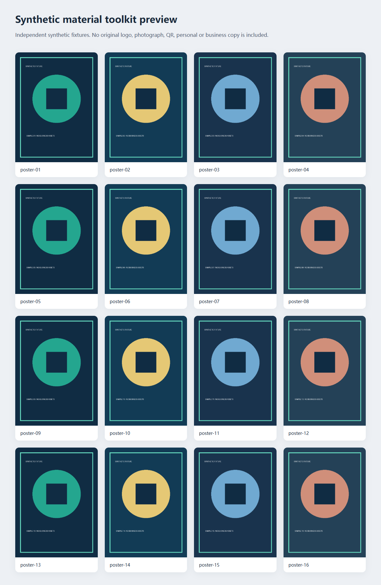
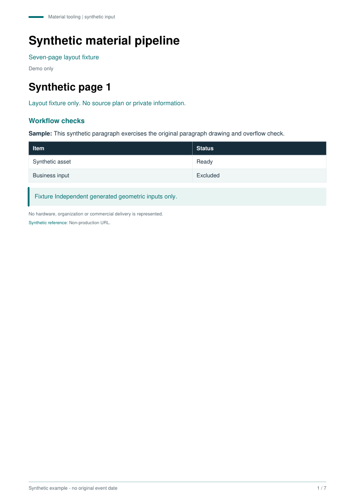

# Campus Material Toolkit · 物料处理脚本归档

从本机校园物料制作中整理出的Python与JavaScript辅助工具：图片复制与校验、HTML总览、ZIP打包、PDF布局、轮廓提取、DOCX排版及历史印刷交付检查。保留57份历史程序（原21份、补查34份、早期2份）的程序与版本关系，把真实业务文字和素材输入换成了明确的合成样例。



[打开合成输出预览](https://yangwei251003.github.io/campus-material-toolkit/) · [示例PDF](docs/demo/sample-plan.pdf) · [示例DOCX](docs/demo/sample-organization.docx) · [16图示例ZIP](docs/demo/posters.zip)

**状态：工具源码归档与合成示例可运行；原业务完整交付链路未复测。** 上图展示脚本实际生成的网页，输入是程序绘制的简单几何图，不含原Logo、照片、二维码、人员信息、预算或活动文案。在线页用于查看工具输出，制作操作仍在本机执行。

## 快速运行

准备Python3.12+、Node24和npm。在仓库根用自己的虚拟环境安装：

```powershell
python -m venv .venv
./.venv/Scripts/Activate.ps1
pip install -r requirements.txt
npm ci --ignore-scripts
python tools/demo.py --workspace C:/work/campus-material-demo
```

Linux/macOS改用`. .venv/bin/activate`，workspace也换成自己的新目录；当前实测系统是Windows。演示要求**全新空目录**，拒绝覆盖已有输入。成功后在workspace/output查看16张PNG/总览/ZIP、7页PDF、4项图像目录，在vector-output查看4种合成轮廓，在organization查看DOCX。单独只跑Python部分可加`--skip-docx`；这是原算法的合成样例，不会复原原活动材料。

本次Python依赖实际可用；完整demo六个程序步骤全部退出0。Node注册表下载发生多次ECONNRESET，未完成全新依赖安装；最终以应用已提供的docx9.6.1运行，并将直接依赖固定到相同版本。package-lock的元数据解析已成功，但测试环境有2个传递包版本与锁树不同，不能称整个锁树已本机验证。GitHub工作流会用全新npm ci再次检查DOCX样例，再发布静态预览；远端结果需实际运行后核实。

## 程序范围

| 目录 | 保存内容与验证 |
|---|---|
| workflows/club/ | 5份原工具：16图保存/打包已实跑；3个Word渲染变体保留不同缩放与诊断方式，未运行Office |
| workflows/event/ | 14份版本/清单/交付脚本：PDF布局、图像目录、4种旧轮廓配置已在合成输入运行；其余历史51/151项生产流程未端到端重测 |
| workflows/organization/ | 原JS排版与Word渲染入口；459项文案/标签字符串改为独立合成JSON，DOCX生成及ZIP/XML读回通过，未验证Word最终分页 |
| public_runtime.py | 显式workspace与可选外部工具参数，不假定私人宿主路径；Word脚本默认先拒绝实际运行 |
| tools/、fixtures/ | 新建隔离输入、可重复demo与Node DOCX检查；均不读取原业务目录 |
| docs/demo/、docs/images/ | 真实合成输出快照与实际浏览器/PDF图，方便直接预览 |

文件与函数/控制结构核对见[源码范围](docs/source-scope.json)，详细边界见[SCRIPT_STATUS.md](SCRIPT_STATUS.md)。这些原本是针对固定材料结构的辅助脚本，保留51/151等流程常量；公开版的业务枚举、路径、文字和断言内容已合成化，不能直接替代原交付数据。

## 自备授权输入与Word前置

先初始化新的独立工作区：

```powershell
python tools/init_workspace.py --workspace C:/work/my-authorized-materials
```

按选用脚本中的相对文件结构放置自己有权使用的输入，再显式传`--workspace`。标记机制用于避免误用原路径，不是处理不可信文件的安全沙箱；原脚本会在选定工作区更新清单或创建输出。

Word渲染脚本额外要求Windows、已授权的Microsoft Word与`pip install -r requirements-word.txt`；只有显式增加`--allow-word`才会进入COM操作。本次仅验证四个入口默认拒绝，未启动Word、打开真实文档或调整真实输出。

`package_visual_delivery.py`还依赖与原API兼容的独立docx校验/打包工具（提供validators.DOCXSchemaValidator及pack.pack），需用`--docx-tools C:/tools/docx-utilities`明确指定。未捆绑第三方Skill全文，也未验证该外部组合。部分旧印刷检查需要Poppler的pdftoppm、指定结构的SVG/PDF与元数据；依赖和输入缺口属于运行前提，不是被遗漏的自有源码。



## 来源、隐私与许可

原23候选逐一核对：20 Python、1 JS保留脱敏对应；两个HTML属于业务文案/外部分享与嵌入内容，不作为原创软件发布。原始21代码的精确副本与SHA只留私有审计，公开版保留函数/控制结构和版本关系，20份Python控制结构计数与原件一致。原商业文字、预算、人员资料、真实图像/Logo/二维码、Word/PDF输入及产出均未打包。

本机脚本与本次整理采用[MIT](LICENSE)；Python/Node库按各自许可使用，尤其PyMuPDF为AGPL/商业双许可，根MIT不改变这些条款。见[第三方声明](THIRD_PARTY_NOTICES.md)。本机原材料和业务数据未完整归档，也没有证明全部历史流程可恢复，**原目录不可据此删除**。


## 补充保全与早期生成器

[第一批补充说明](supplement/README.md)保全此前分散于CJS与output目录的34个独有程序；[早期生成器说明](supplement/EARLY_ADDENDUM.md)另外保存2个不同HTML/DOCX渲染程序。3个早期业务数据模块是纯数据，不计作工具；公开替换为结构对应的明确合成输入，真实预算、姓名、联系方式及素材不带入。

补充源码默认阻止直接执行原业务；实际合成处理覆盖透明蒙版、图片去重/裁切、出血和物理尺寸PDF及13图标渲染，桌面/手机预览无错误或外部请求。早期渲染器真实产出25表/15有效锚点HTML，以及26 ZIP成员、1657段落、33表格的DOCX，未启动Word验证分页；工作流完整新环境依赖安装仍以远端CI为准。

[补充合成输出预览](https://yangwei251003.github.io/campus-material-toolkit/supplement/) · [早期生成器合成输出预览](https://yangwei251003.github.io/campus-material-toolkit/early-generator/)。源码范围与验证摘要分别在对应子目录，主程序表的21项仍对应第一批来源，不覆盖后续版本差异。原57程序以外的真实业务资料、照片与Office链路未全部托管，原文件夹继续保留。
