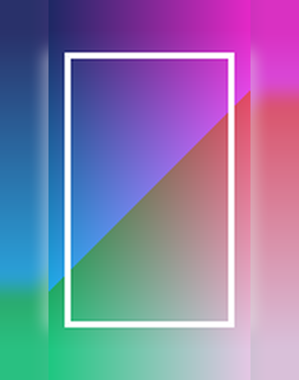
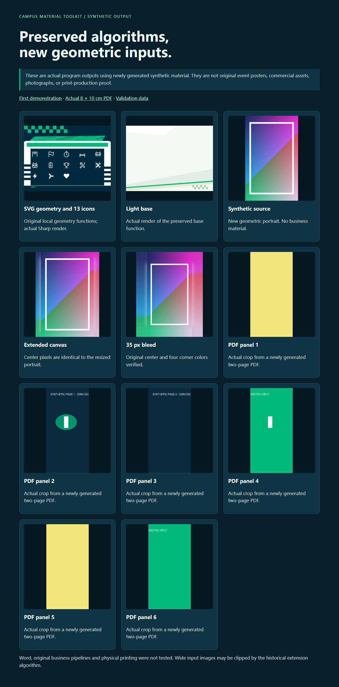

# 运行合成示例

这些图片来自实际程序输出，使用新造几何素材；它们是**合成示例，不是原活动、原商业项目或实物印刷截图**。






## 环境准备

Python 3.12 与 Node.js 24 为本机测试环境。先在仓库根目录创建虚拟环境并安装两项 Python 依赖：

```powershell
python -m venv .venv
.venv\Scripts\python -m pip install -r supplement/requirements.txt
.venv\Scripts\python supplement/demo.py --workspace .runtime/supplement-demo
```

macOS/Linux 可把 `.venv\Scripts\python` 换成 `.venv/bin/python`。跨平台没有在本机测试。

命令要求一个新空工作区。它生成几何图像和两页 PDF，运行原有图片提取、透明蒙版重组及六分栏裁切，核对中心像素、出血边角、PDF 物理尺寸和输入文件完整性。输出及机器可读结论位于工作区。它不需要 Word、真实照片、Logo 或二维码。

SVG 示例：

```powershell
npm install --prefix supplement
node supplement/demo_svg.cjs --output .runtime/svg-demo
```

它调用原有 10 个几何辅助函数，生成 13 种图标并用 Sharp 真正渲染 PNG。没有捆绑原字体、照片或 Logo。首次联网安装全部依赖没有在此次归档中重新完成；本机运行复用了现有第一方运行环境中的同版本 Sharp。

## 已验证与限制

- 窄竖图居中内容保持相同像素，扩展背景；出血区域保留中心与四角颜色。
- PDF 页面实际为 8×10 厘米（排版点数换算核验）。没有声称经过印厂打样或色彩管理。
- 合成 PDF 中重复使用的图像只提取一次，透明蒙版保留为 RGBA；六个分栏均生成 PNG。
- 旧 `edge_extended_canvas` 对过宽图片会裁切；示例只验证窄竖图，不把它宣传为通用无裁切算法。
- 历史其余程序仅完成源码保全、语法及默认入口阻断核验。原完整文档排版、二维码识别、中文字体、全套印刷包与 Word COM 没有验证。

[静态输出预览](../docs/demo/supplement/index.html)展示的也是合成结果；Pages 部署状态由主仓库发布流程决定。
