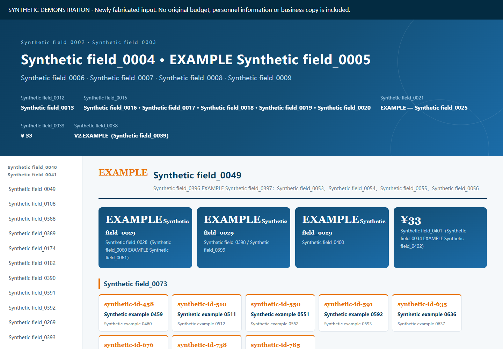

# 早期版本补充

在第一、二阶段的 55 个历史程序之外，本轮找到两套不同的早期实现：DOCX 文档生成器和 HTML 长页生成器。**工具箱目前保全 57 个历史程序文件**；同批三个业务数据模块只作为输入分类，不计为三个软件项目，原文案、预算和人员资料不公开。

入口与详细说明：[早期生成器](../workflows/early-document-builders/README.md)。公开的三份 JSON 是新造的合成输入，保留必要字段结构；1285 个字符串全部标为 Synthetic，数值均为 1。没有把原业务资料整包上传。

[实际合成网页](../docs/demo/early-generator/index.html) · [实际生成的合成 DOCX](../docs/demo/early-generator/synthetic-report.docx)

两套生成器保留不同于后期版本的布局和控制代码；文件 SHA 和完整 AST 结构均不相同。通用排版模式的相似性不足以证明直接版本祖先关系，故按并存历史实现归档，没有覆盖后期版本。

Windows/Node.js 24 实测：HTML 有 25 个表格，15 个内部导航锚点均有目标，Chrome 桌面与手机预览无页面错误、外部请求及整页横向溢出；DOCX 有 26 个 ZIP 条目、1657 个段落、33 个表格、0 个嵌入媒体且 CRC 校验通过。**没有启动 Word，未验证真实排版分页或原业务内容复现。**

自有代码沿用根 MIT，第三方 docx 依赖保留原许可边界。原始输入、其他业务资料和原项目仍需留在本地，当前不属于可删除原件项目。
